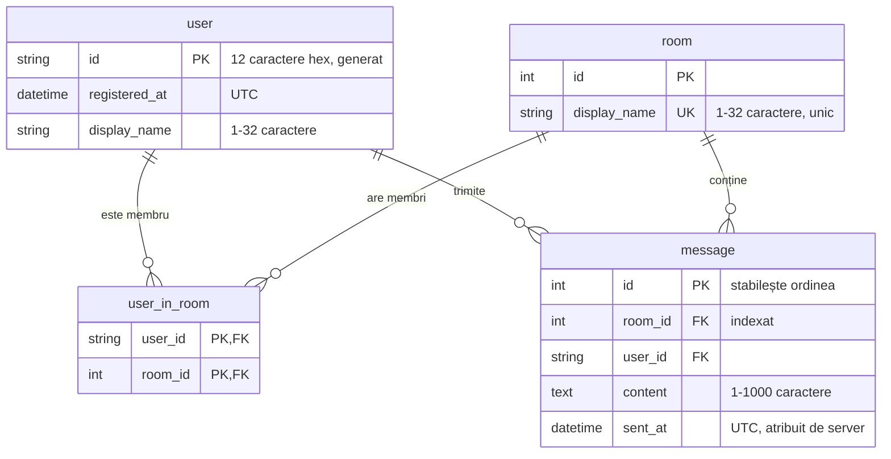

# MiniChat — mesagerie locală cu istoric

**Subiectul 44** · MiniChat - camere tematice · Python 3.14 · Flask + Socket.IO + SQLite

Aplicație de chat pe camere, cu server Python local și client web. Serverul și două-trei ferestre-client rulează pe același laptop, fără internet. Mesajele se păstrează în SQLite și se recuperează după o deconectare.

---

## 1. Prezentare generală și obiective

### Titlul proiectului și echipa

| Membru | Grupa | GitHub |
|---|---|---|
| Popa Ghita Didita Nicola Andra |422C | [AndraN414](https://github.com/AndraN415) |
| Duna Bianca Stefania | 422C | [AndraN414](https://github.com/DunaBianca) |

### Context și scop (problem statement)

Un grup mic (de exemplu, o echipă la laborator) are nevoie de o mesagerie care funcționează complet local: fără conturi în cloud, fără internet, cu istoric care nu se pierde dacă un client sau serverul se oprește. Utilizatorii țintă sunt **utilizatori demonstrativi** cu identități fictive. Aceștia schimbă mesaje în camere tematice printr-un server Python care rulează pe același calculator sau în aceeași rețea locală.

### Obiective principale (SMART)

1. **Server local cu validare.** Fiecare mesaj este acceptat doar dacă expeditorul are o sesiune validă și este membru al camerei. Serverul atribuie fiecărui mesaj un ID și un marcaj temporal UTC și respinge textul gol sau mai lung de 1000 de caractere.
2. **Istoric persistent.** Toate mesajele se salvează în SQLite. La deschiderea unei camere și după fiecare reconectare se reîncarcă ultimele 100 de mesaje, fără dubluri.
3. **Mesaje în timp real, fără blocarea interfeței.** Socket.IO livrează mesajele (WebSocket, cu interogare periodică ca rezervă) pentru minimum 3 clienți simultani.
4. **Calitate verificată automat.** O suită de 116 teste automate acoperă toate rutele HTTP și toate evenimentele Socket.IO. Suita rulează la fiecare pornire a serverului.

### Limitele proiectului (scope limitations)

- **Fără parole și fără OAuth.** Autentificarea folosește un ID generat la înregistrare, adică o identitate fictivă cu ID stabil. ID-ul este singura credențială.
- **Fără HTTPS.** Aplicația este destinată exclusiv rulării pe același laptop sau în aceeași rețea locală.
- **Fără cloud.** Stocarea este un fișier SQLite local (`db.sqlite`), fără replicare.
- **Fără administrare.** Nu există roluri de administrator sau moderator și nu se pot șterge sau edita mesaje.
- **Fără atașamente.** Nu se trimit fișiere sau imagini și nu există notificări pentru camerele care nu sunt deschise.
- **Server de dezvoltare.** Aplicația folosește serverul de dezvoltare Werkzeug, potrivit pentru demonstrație, nu pentru producție.

---

## 2. Cerințe funcționale

### Funcționalități

**Must-have (implementate)**

1. Înregistrare cu nume afișat (1–32 caractere). Serverul generează un ID de autentificare de 12 caractere hexazecimale.
2. Autentificare cu ID-ul primit și deconectare. Sesiunea Flask este semnată și durează 7 zile.
3. Camere: creare (nume unic), intrare ca membru (_Join_) și părăsire (_Leave_).
4. Clasificarea camerelor în interfață după permisiune: _Your rooms_ (`member`) și _Other rooms_ (`none`).
5. Trimiterea și primirea mesajelor în timp real, în camera selectată.
6. Istoric salvat în SQLite. La deschiderea camerei se încarcă ultimele 100 de mesaje.
7. Reconectare automată. După revenirea serverului, clientul reintră în cameră și reîncarcă istoricul.
8. Verificarea permisiunii la fiecare mesaj primit: clientul apelează `GET /api/rooms/<id>/permission` înainte de afișare.

**Nice-to-have (în afara versiunii curente)**

- Notificări sau contor de mesaje necitite pentru celelalte camere.
- Paginarea istoricului mai vechi de 100 de mesaje.
- Editarea sau ștergerea propriilor mesaje.

### Corespondența cu cerințele subiectului 44

| Cerință | Stare | Cum este rezolvată |
|---|---|---|
| Server local și interfață-client | ✅ | Server Flask-SocketIO pe portul 5000, client web în browser |
| Identitate fictivă cu ID stabil | ✅ | ID de 12 caractere hex, generat la înregistrare și folosit la autentificare |
| Serverul verifică expeditorul și apartenența la conversație | ✅ | Expeditorul este luat din sesiunea semnată, nu din datele trimise de client. Apartenența se verifică în `user_in_room` la fiecare mesaj |
| ID și marcaj temporal atribuite de server | ✅ | `message.id` (autoincrement) și `message.sent_at` (UTC) |
| Respingerea textului gol sau prea lung | ✅ | 1–1000 de caractere după curățare (vezi [Validarea datelor primite](#interfața-serverului)); altfel răspuns `{"ok": false, "error": ...}` |
| Trimitere și primire fără blocarea interfeței | ✅ | Socket.IO asincron; o coadă de promisiuni păstrează ordinea de sosire |
| Ordinea stabilită de server | ✅ | Istoricul este ordonat după `message.id`, nu după ceasul clientului |
| Mesaje salvate în SQLite | ✅ | Tabelul `message` |
| Reluarea citirii după ultimul ID primit | 🟡 Parțial | La reconectare se reîncarcă ultimele 100 de mesaje și se elimină dublurile după ID. Nu există încă un parametru „după ID-ul X” |
| Trimitere repetată cu același identificator de operație fără duplicat | ⏳ Planificat | Nu este implementată încă |
| Recuperarea istoricului lipsă după reconectare | 🟡 Parțial | Funcționează pentru ultimele 100 de mesaje ale camerei |
| Afișarea conversației, autorului, timpului și formularului | ✅ | Pagina de chat |
| Starea conexiunii și mesaje clare la oprirea serverului | 🟡 Parțial | Mesajul „Connection lost, retrying…” la pierderea conexiunii. Lipsește un indicator permanent de stare |
| Un mesaj neconfirmat nu apare ca trimis | ✅ | Mesajul apare doar după ce serverul îl salvează și îl difuzează. Câmpul de text se golește doar după confirmare |
| Adnotări de tip | ⏳ Planificat | |
| Teste automate: flux normal, caz-limită, caz de eroare | ✅ | 116 teste, vezi [Strategia de testare](#strategia-de-testare) |
| Regula variantei alese (44A/44B) | ⏳ | _de completat după alegerea variantei_ |

### Modelul de date

Permisiunea unui utilizator într-o cameră este derivată din `user_in_room`: `member` dacă există rândul respectiv, altfel `none`.
